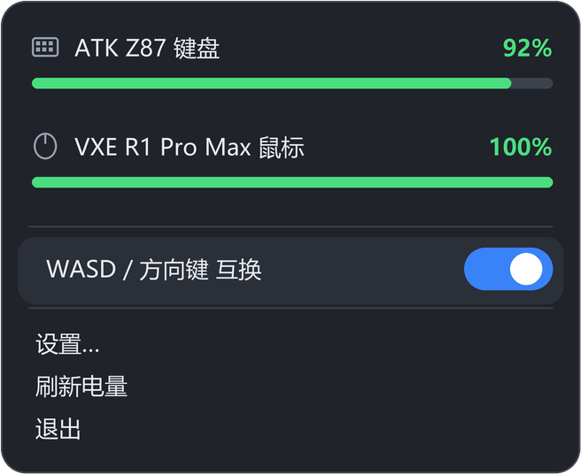
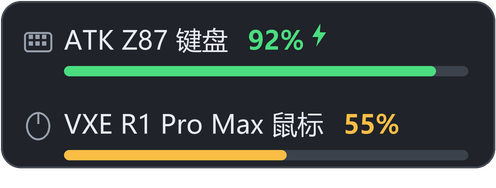
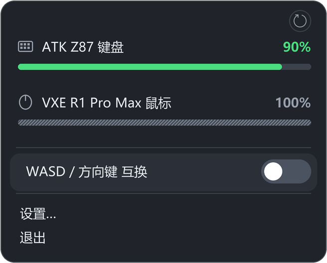
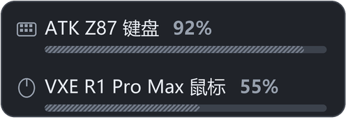

# ATK 自制驱动 · ATK Battery Tray

[](https://www.python.org/)
[](https://www.microsoft.com/windows)
[](LICENSE)

一个 Windows 托盘小工具：**同时显示无线键盘和鼠标的电量**，再加一个 **WASD ↔ 方向键 一键互换** 开关。
不用装官方驱动，纯 Python 标准库（ctypes + tkinter），打包后单文件 exe 开箱即用。

> 起因：官方的 ATK HUB 太重，而我只需要「看一眼电量」和「刷视频时一键把 WASD 换成方向键」两件事。



## 特性

- **一个托盘图标**：鼠标悬停弹出两行电量卡片，点一下打开面板（真的只有一个图标，不再多占位置）
- **弹出位置固定**：卡片和面板都贴着托盘图标居中，**不跟着鼠标漂**，每次都在同一处
- **自动钉在任务栏**：Win11 默认把新图标塞进 `^` 隐藏区，本工具启动时发现被收进去会自己出来
- **键盘 + 鼠标电量**：直接和 2.4G 接收器对话，**不依赖任何厂商驱动**
- **休眠也显示电量**：读不到时显示上次读到的百分比（灰色）+ 斜纹电量条，一看就知道是旧数据而不是没电
- **WASD ↔ 方向键 互换**：面板开关或全局热键，随时可撤，**不修改键盘固件**
- **热键可自定义**：设置里点「录制」按下组合键即可，也能关掉
- **悬停延迟可调**：默认停留 0.35 秒才弹出电量卡片，避免鼠标路过时闪烁
- **开机自启**（可选，写 HKCU\Run）
- **插件化**：`plugins/` 丢一个 `.py` 就多一个功能，不用重新打包
- **抗锯齿界面**：整块面板用 PIL 3 倍超采样绘制，Per-Monitor V2 高 DPI，不糊



## 已支持的设备

| 设备 | VID:PID | 通道 | 请求 → 电量 |
|---|---|---|---|
| ATK Z87 / ATK 系列键盘 | `373B:1012` 等 | HID `0xFF1C`，64 字节 | `04 11 00 1A` → 回包 `[8]` |
| VXE R1 Pro Max / VGN 等鼠标 | `3554:F58A` | HID `0xFF02`，17 字节 | `08 04 … 49` → 回包 `[6]` |
| ATK / VXE / VGN 鼠标（Nordic 52840） | `373B:*` | HID `0xFF02`，17 字节 | 同上 |

协议整理自社区公开逆向成果（见文末致谢）。**其他设备**可以在 `config.py` 的 `READERS` 里加一个读取函数，
或者在 issue 里贴上接收器的 VID:PID 和抓到的报文。

## 快速开始

### 直接用 exe（推荐）

1. 到 [Releases](../../releases) 下载 `ATK-Battery-Tray.exe`
2. 放到一个固定目录（**`plugins` 文件夹要和 exe 同级**）
3. 双击运行。Win11 首次会把它收进托盘溢出区 `^`，**程序会自动把自己钉回任务栏**；
   想让它老实待在隐藏区，就把 config.json 里的 `pin_tray` 改成 `false`
4. exe 未签名，首次运行如遇 SmartScreen 提示，选「更多信息 → 仍要运行」

### 从源码运行

```bat
pip install pillow
python main.py
```

需要 Python 3.10+（含 tkinter）。

## 使用

| 操作 | 效果 |
|---|---|
| 鼠标悬停在托盘图标上 | 弹出两行电量卡片 |
| 左键 / 右键点托盘图标 | 打开面板 |
| 面板里点开关 | 开启 / 关闭 WASD ↔ 方向键互换 |
| `Ctrl+Alt+W` | 默认全局热键，切换互换（可在设置里改） |
| 设置… | 修改热键、开机自启、电量刷新间隔 |
| 刷新电量 | 立即重新读取 |

**互换开启时**：按 W/A/S/D 出来的是 ↑/←/↓/→，按方向键出来的是 WASD。
带 `Ctrl / Alt / Shift / Win` 时不互换（`Ctrl+W` 还是关窗口），这是刻意设计的。



设备休眠读不到电量的时，名字后面显示**上次读到的百分比（灰色）**，电量条变成**灰色斜纹**——
斜纹表示「这不是实时读数」，同时数字还留着，不会像空条那样看着像没电。动一下设备就会恢复绿色实时条。



## 已知限制

- 只在 **Windows 10/11** 生效，程序需要保持运行，退出即恢复原样
- 以管理员权限运行的程序里，按键互换可能不生效（Windows 权限机制）
- 极少数使用原始输入的程序可能收不到改键
- 设备休眠时读不到实时电量（显示上次的值 + 灰色斜纹条，动一下设备即更新）
- 和 PowerToys 键盘管理器、AutoHotkey 等改键软件同时开可能冲突

## 插件

`plugins/` 里放一个 `.py`，重启程序后自动加载（以 `_` 开头的文件会被跳过）：

```python
def register(ctx):
    ctx.add_menu_item("打印电量", lambda: print(ctx.battery()))
```

`ctx` 提供 `add_menu_item(标签, 回调)`、`battery()`、`config()`、`toggle_swap()`。

## 打包

```powershell
pip install pillow pyinstaller
pyinstaller --noconfirm --clean --onefile --noconsole `
  --name "ATK自制驱动" --icon assets/app.ico --manifest dpi.manifest `
  --add-data "assets/app.ico;assets" --hidden-import PIL.ImageTk --hidden-import PIL._tkinter_finder `
  main.py
```

注意：`--manifest dpi.manifest` 是必须的，否则打包后的程序会被系统按 1.25 倍拉伸，界面发虚。

## 项目结构

```
main.py       入口：单实例、托盘、面板、设置、电量刷新、插件加载
hiddev.py     HID 枚举 + 各厂商电量协议
keyswap.py    低级键盘钩子实现的 WASD 互换（含修饰键保护、注入标记防死循环）
hotkey.py     RegisterHotKey 全局热键
tray.py       Shell_NotifyIcon 托盘 + 图标矩形查询（贴图标定位、钉任务栏、隐藏区判定）
panel.py      浮动面板 / 悬停卡片 / 设置窗口
render.py     PIL 抗锯齿绘制
config.py     %APPDATA%\设备电量\config.json
autostart.py  HKCU Run 开机自启
plugins/      用户插件目录
```

## 致谢

- 协议参考：[Ap0LoG1zE/EZ2.4G](https://github.com/Ap0LoG1zE/EZ2.4G)（抓包学习思路）、
  [yszyszysz233/2.4G-battery-viewer](https://github.com/yszyszysz233/2.4G-battery-viewer)（VXE / ATK 报文格式）
- 界面参考：Windows 11 深色卡片 + 常见托盘工具排版

## License

[MIT](LICENSE) —— 拿去改、拿去用，出问题别找我 :)

